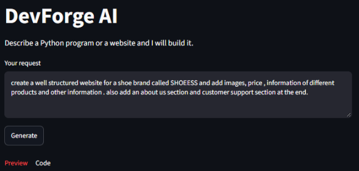
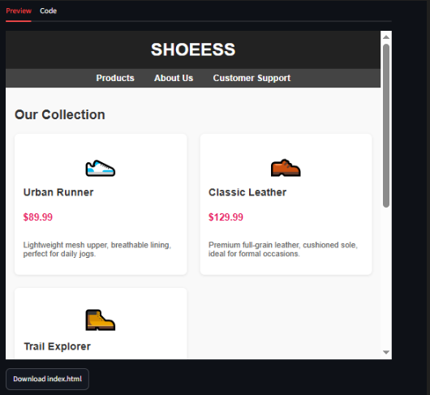
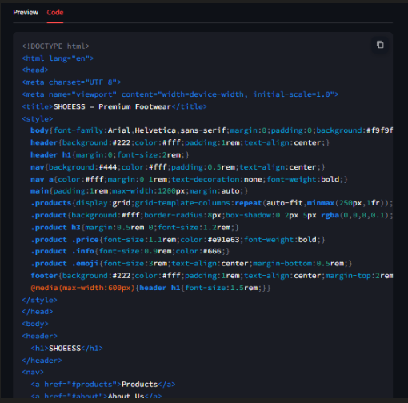

# DevForge AI

An autonomous AI coding agent that doesn't just write code. It **runs it, reads the result, and fixes errors on its own**.

Describe a Python program or a website in plain English. DevForge AI generates it, executes it, and if something fails, sends the error back to the LLM and tries again.

> **Status:** Complete (v1). The next version is **ShipForge AI**, which adds approval, GitHub push, scheduling, and LinkedIn posting.

## Screenshots

**1. Enter a request**



**2. Live website preview**



**3. Generated code**



## Features

- **Python generation:** natural language to working Python code
- **Auto-execution:** captures output, errors, and exit code
- **Self-healing loop:** failed runs are fixed by the LLM (up to 3 retries)
- **Website builder:** single-file `index.html` with live preview and download
- **REST API:** FastAPI backend with Pydantic request validation
- **Clean UI:** Streamlit interface showing code, output, errors, or a website preview

## Architecture

```
Streamlit UI  -->  FastAPI  -->  LangGraph Agent  -->  Tools
   (ui.py)        (api.py)       (agent.py)          (tools.py)
```

**Agent flow**

```
START -> llm_node -> tools -> llm_node -> ... -> END
```

The LLM decides which tool to call. After each execution, the result returns to the LLM. On failure it fixes the code and retries. On success the loop ends. A hard stop (`recursion_limit=15`) prevents endless loops.

**Tools**

| Tool | What it does |
|------|--------------|
| `write_code` | Saves generated Python code to `generated_code.py` |
| `execute_code` | Runs the file with a 10-second timeout and returns output, error, and exit code |
| `check_result` | Checks the exit code to decide success or failure |
| `write_html_code` | Saves a complete website to `website/index.html` |

## Tech Stack

Python, LangGraph, LangChain, Groq (`openai/gpt-oss-20b`), FastAPI, Pydantic, Uvicorn, Streamlit

## Project Structure

```
DevForge_AI/
├── backend/
│   ├── agent.py      # LangGraph workflow
│   ├── api.py        # FastAPI app
│   ├── model.py      # LLM and tool binding
│   ├── tools.py      # Agent tools
│   └── ui.py         # Streamlit UI
├── screenshots/
├── .env              # API key (not committed)
├── .gitignore
├── requirements.txt
└── README.md
```

## Setup

**1. Clone and install**

```bash
git clone <your-repo-url>
cd DevForge_AI
python -m venv venv
venv\Scripts\activate        # Windows
pip install -r requirements.txt
```

`requirements.txt` should contain:

```
langgraph
langchain
langchain-groq
streamlit
python-dotenv
fastapi
uvicorn
requests
pydantic
```

**2. Add your Groq API key**

Create a `.env` file in the project root:

```
GROQ_API_KEY=your_key_here
```

**3. Start the backend** (terminal 1)

```bash
cd backend
uvicorn api:app --reload
```

**4. Start the UI** (terminal 2)

```bash
cd backend
streamlit run ui.py
```

Open `http://localhost:8501`. API docs are at `http://localhost:8000/docs`.

## API

**`POST /generate`**

Request:

```json
{ "query": "Write a program that adds 5 and 3" }
```

Response (Python):

```json
{
  "type": "python",
  "code": "print(5 + 3)",
  "output": "8\n",
  "error": "",
  "message": "..."
}
```

Response (website):

```json
{ "type": "website", "html": "<!DOCTYPE html>...", "message": "..." }
```

## Example Prompts

- `Write a program that prints the first 10 Fibonacci numbers`
- `Create a student record manager using a dictionary`
- `Make a simple portfolio website`

## Known Limitations

- Code runs **locally** with `subprocess` and a 10-second timeout. It is **not sandboxed**, so avoid untrusted prompts on a machine with sensitive files.
- The retry limit of 3 is enforced by the prompt. The hard stop is `recursion_limit=15`.
- Code that runs without errors is not guaranteed to be logically correct.
- Web servers (Flask, Streamlit apps) are not supported, because they never exit and hit the timeout.
- Websites are generated as one `index.html` file.
- The API uses shared files, so it handles one request at a time.
- Small models may occasionally return malformed tool calls.

## What's Next: ShipForge AI

These limitations are fixed in the next version, **ShipForge AI**:

- Docker sandbox, one folder per run, and model fallback
- Human approval before every GitHub push
- Scheduled push and LinkedIn post
- Auto-generated README and LinkedIn draft
- Upload existing code and continue to GitHub and LinkedIn

## Key Concepts Demonstrated

LLM tool calling, LangGraph state and conditional routing, retry loops with limits, REST API design with FastAPI and Pydantic, UI and API separation, and awareness of the risks of running AI-generated code.